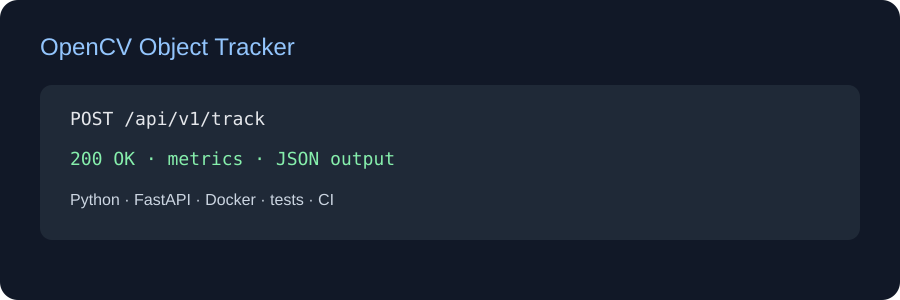

# OpenCV Object Tracker

[English](README.md) | [Türkçe](README_TR.md)

FastAPI tracking service that turns consecutive object centroids into displacement, speed and frame metrics. It is an explainable core for an OpenCV video worker.

## Stack
Python, OpenCV integration boundary, centroid tracking math, FastAPI, Docker, pytest and CI. A production worker can decode video frames with cv2, plug in a detector, and persist tracks.

## Run
POST /api/v1/track accepts previous/current pixel coordinates, frame count and FPS.

    pip install -e ".[dev]"
    uvicorn app.main:app --reload
    pytest -q

Docker: docker compose up --build. Docs: /docs.

